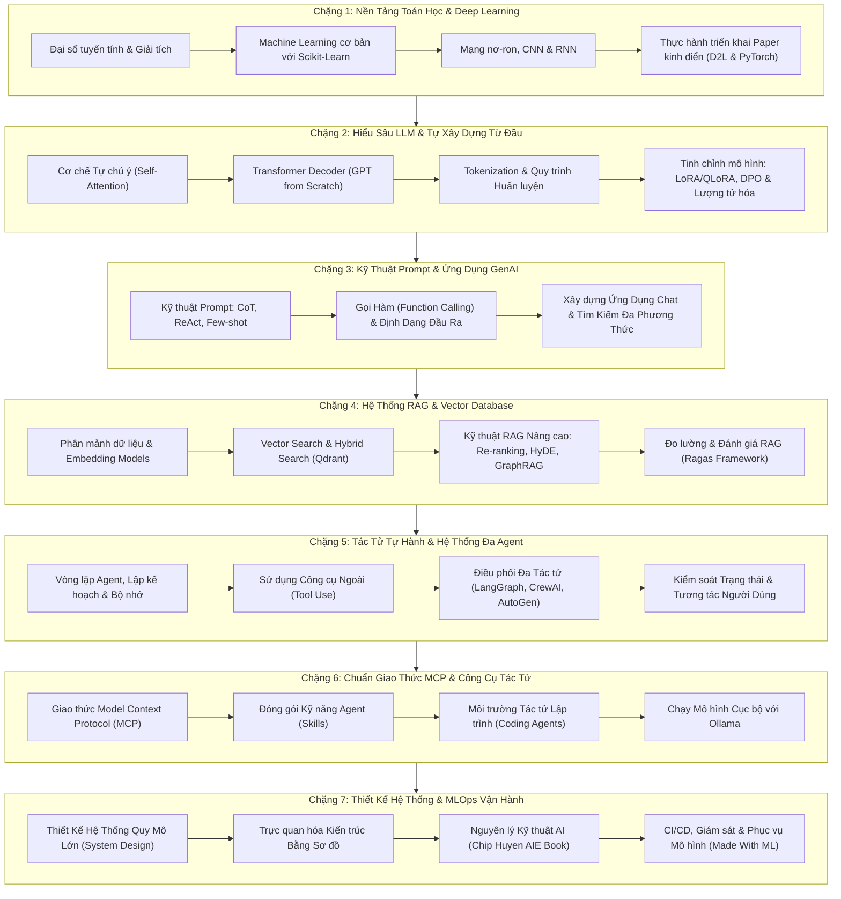
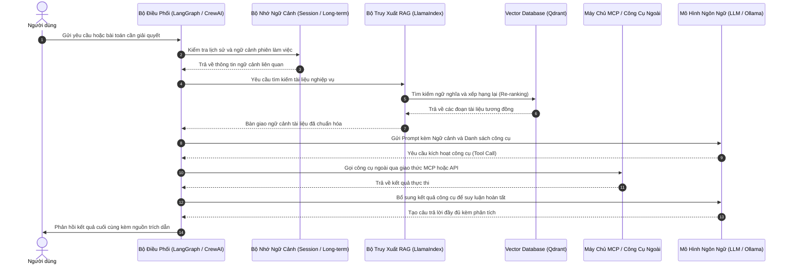

# AI Engineering & Autonomous Agents Learning Hub

Không gian tổng hợp tài liệu, giáo trình thực hành và mã nguồn được thu thập, đúc kết trong quá trình tự học và nghiên cứu về AI Engineering, Large Language Models (LLM), Hệ thống tác tử tự hành (Autonomous Agents) và MLOps.

Kho lưu trữ này được xây dựng với mục đích chính là làm nơi tự học, lưu trữ các dự án thực nghiệm cá nhân, đồng thời chia sẻ một thư viện tham khảo có hệ thống cho cộng đồng những người đang tìm hiểu và theo đuổi con đường AI Engineering.

---

## 1. Đôi Nét Về Kho Lưu Trữ

Trong quá trình tìm tòi và học tập về AI, các tài liệu chất lượng cao từ lý thuyết toán, mô hình ngôn ngữ lớn đến các framework điều phối tác tử thường nằm rải rác ở rất nhiều nguồn khác nhau. Việc vừa học vừa tổng hợp lại giúp người học:
* Có cái nhìn liền mạch từ nền tảng toán học, cách xây dựng mô hình từ đầu cho đến ứng dụng vào thực tế sản xuất.
* Lưu trữ mã nguồn mẫu để có thể trực tiếp chạy, chỉnh sửa, thử nghiệm và gộp các ý tưởng lại với nhau.
* Tạo ra một danh mục tham chiếu thuận tiện để khi cần giải quyết một bài toán cụ thể (RAG, Multi-Agent, Tool Use, Evaluation) có thể tra cứu và đối chiếu nhanh chóng.

Kho lưu trữ được chia làm hai khu vực chính:
* Thư mục gốc: Tuyển tập 93+ dự án thực hành mã nguồn mở về Computer Vision, OCR, Chat UI, Reasoning UI, RAG đa phương thức và hệ thống Multi-Agent MCP.
* Thư mục `curated-courses/`: 50 bộ giáo trình, dự án và tài liệu được gom lại từ các chuyên gia, trường đại học và tổ chức mã nguồn mở trên thế giới.

---

## 2. Cấu Trúc Tổ Chức Thư Mục

```
AI-ENGINEERING-HUB/
|-- [93+ Root Projects]             # Các ứng dụng và dự án mẫu thực hành độc lập
|-- curated-courses/                # 50 bộ giáo trình và tài nguyên chuyên sâu
|   |-- aie-book-chiphuyen/         # Tài nguyên sách AI Engineering của Chip Huyen
|   |-- langchain-framework/       # Framework LangChain
|   |-- langgraph-orchestration/    # Framework LangGraph điều phối tác tử dạng đồ thị
|   |-- crewai-multi-agent/         # Framework CrewAI cho hệ đa tác tử
|   |-- qdrant-vector-database/     # Cơ sở dữ liệu vector Qdrant
|   |-- ragas-eval-framework/       # Thư viện đánh giá chất lượng RAG
|   |-- ollama-local-llms/          # Công cụ chạy LLM trên máy cá nhân
|   |-- awesome-mcp-servers-catalog/# Danh mục Model Context Protocol
|   |-- mcp-reference-servers/      # Bộ máy chủ MCP mẫu chuẩn hóa
|   |-- superpowers-coding-skills/  # Khung kỹ năng cho coding agent
|   |-- claude-code-agents-suite/   # Bộ công cụ điều phối tác tử cho Claude Code
|   |-- claude-mem-plugin/          # Plugin nén và ghi nhớ phiên làm việc
|   |-- claude-flow-orchestration/  # Điều phối workflow đa tác tử ruFlo
|   |-- planning-with-files/        # Quản trị kế hoạch làm việc bằng Markdown
|   |-- claude-scientific-skills/   # Kỹ năng phân tích số liệu và nghiên cứu
|   |-- claude-code-guide/          # Hướng dẫn cấu hình Claude Code và SKILL.md
|   |-- oh-my-claudecode/           # Tiện ích mở rộng đa tác tử dựng sẵn
|   |-- ecc-agent-harness/          # Tối ưu harness, bộ nhớ và bảo mật agent
|   |-- teamai-cli-tencent/         # CLI chia sẻ kỹ năng và cấu hình nhóm
|   |-- pi-desktop-agent-env/       # Môi trường desktop local-first cho agent
|   |-- openai-plugins/             # Tài liệu và mẫu plugin từ OpenAI
|   |-- diagram-design/             # Mẫu thiết kế sơ đồ hệ thống cho AI tools
|   |-- system-design-notes/        # Ghi chú thiết kế hệ thống phân tán
|   |-- ultimate-ai-engineer-roadmap-2026/ # Lộ trình tham khảo AI Engineer 2026
|   |-- microsoft-ml-for-beginners/ # 12 tuần Machine Learning qua Scikit-Learn
|   |-- microsoft-ai-for-beginners/ # Mạng neural, Computer Vision, NLP
|   |-- microsoft-generative-ai-for-beginners/ # 21 bài học xây dựng ứng dụng GenAI
|   |-- microsoft-ai-agents-for-beginners/ # 18 bài học về hệ thống AI Agents
|   |-- microsoft-autogen/          # Framework đàm thoại đa tác tử của Microsoft
|   |-- karpathy-nn-zero-to-hero/   # Xây dựng mạng neuron từ micrograd đến GPT
|   |-- karpathy-nanochat/          # Quy trình huấn luyện và giao diện chat
|   |-- rasbt-llms-from-scratch/    # Tự lập trình GPT từ đầu bằng PyTorch
|   |-- llm-course/                 # Lộ trình LLM Scientist & Engineer (Maxime Labonne)
|   |-- huggingface-llm-course/     # Giáo trình chính thức từ Hugging Face
|   |-- ai-engineering-from-scratch/# Tự code Transformer, Vector DB, RAG từ số 0
|   |-- rag-techniques-nirdiamant/  # Tổng hợp các kỹ thuật RAG nâng cao
|   |-- genai-agents/               # Kiến trúc Agent thực tế (Planning, Memory)
|   |-- llama-index-core/           # Framework kết nối dữ liệu riêng với LLM
|   |-- awesome-llm-apps/           # Bộ sưu tập hơn 100 ứng dụng Agent và RAG
|   |-- claude-cookbooks/           # Hướng dẫn thực hành gọi công cụ và đánh giá
|   |-- anthropic-agent-skills/     # Tiêu chuẩn đóng gói kỹ năng cho Agent
|   |-- agentic-loop-engineering/   # Thiết kế vòng lặp điều khiển trạng thái
|   |-- deep-learning-paper-implementations/ # 60+ mô hình PyTorch theo paper
|   |-- dive-into-deep-learning/    # Sách tương tác D2L kèm mã nguồn
|   |-- deep-learning-book/         # Sách Deep Learning của Ian Goodfellow
|   |-- prompt-engineering-guide/   # Cẩm nang kỹ thuật prompt quốc tế
|   |-- made-with-ml/               # MLOps, CI/CD và vận hành mô hình
|   |-- learn-ai-engineering/       # Bản đồ kiến trúc hệ thống AI Engineer
|   |-- ai-expert-roadmap/          # Sơ đồ kỹ năng Machine Learning & AI
|   `-- awesome-machine-learning/   # Danh bạ thư viện ML theo ngôn ngữ
|-- README.md                       # Tài liệu hướng dẫn trung tâm
`-- LICENSE                         # Giấy phép mã nguồn mở MIT
```

---

## 3. Lộ Trình Tham Khảo Khi Tự Học

Dưới đây là sơ đồ gợi ý lộ trình học tập được tổng kết từ các giáo trình có trong kho lưu trữ, giúp người học định hình các bước đi từ cơ bản đến phức tạp:



---

## 4. Mô Hình Hoạt Động Của Một Hệ Thống Agentic RAG Điển Hình

Sơ đồ tuần tự thể hiện cách thức một ứng dụng AI hiện đại tiếp nhận yêu cầu, kết hợp bộ nhớ, tra cứu dữ liệu và gọi công cụ để trả lời:



---

## 5. Danh Mục Chi Tiết 50 Khóa Học & Dự Án Trong `curated-courses/`

Dưới đây là bảng tổng hợp các tài nguyên đã được phân loại theo từng nhóm chủ đề để tiện theo dõi và học tập:

### Nhóm 1: Nền Tảng Machine Learning & Deep Learning
Tập hợp các tài liệu giúp củng cố kiến thức giải tích, đại số ma trận, học máy cơ bản và cấu trúc mạng neuron.

| STT | Tên Thư Mục | Tác Giả / Nguồn | Tóm Tắt Nội Dung |
|---|---|---|---|
| 1 | [`microsoft-ml-for-beginners`](./curated-courses/microsoft-ml-for-beginners) | Microsoft | Khóa học 12 tuần về học máy cổ điển qua Scikit-Learn với các bài tập dữ liệu thực tế. |
| 2 | [`microsoft-ai-for-beginners`](./curated-courses/microsoft-ai-for-beginners) | Microsoft | Giáo trình mạng neuron, Computer Vision, NLP và Transformers trên PyTorch và TensorFlow. |
| 3 | [`karpathy-nn-zero-to-hero`](./curated-courses/karpathy-nn-zero-to-hero) | Andrej Karpathy | Tự viết bộ vi phân tự động micrograd, mô hình makemore đến kiến trúc GPT từ con số 0. |
| 4 | [`deep-learning-book`](./curated-courses/deep-learning-book) | Ian Goodfellow | Tổng hợp và mục lục học trực tuyến cuốn sách giáo khoa Deep Learning của MIT Press. |
| 5 | [`dive-into-deep-learning`](./curated-courses/dive-into-deep-learning) | D2L.ai | Sách giáo khoa tương tác kèm mã nguồn chạy trên các framework PyTorch và JAX. |
| 6 | [`deep-learning-paper-implementations`](./curated-courses/deep-learning-paper-implementations) | Phil Wang (lucidrains) | Bộ mã nguồn PyTorch thuần thực thi hơn 60 bài báo nghiên cứu: Diffusion, ViT, RoPE, Attention. |
| 7 | [`awesome-machine-learning`](./curated-courses/awesome-machine-learning) | Joseph Misiti | Danh bạ thư viện và công cụ học máy mã nguồn mở phân loại theo ngôn ngữ lập trình. |

### Nhóm 2: Tìm Hiểu LLM & Xây Dựng Từ Đầu (Build From Scratch)
Các dự án giúp hiểu rõ cấu trúc Transformer Decoder, cơ chế Attention và quy trình huấn luyện/tinh chỉnh mô hình.

| STT | Tên Thư Mục | Tác Giả / Nguồn | Tóm Tắt Nội Dung |
|---|---|---|---|
| 8 | [`rasbt-llms-from-scratch`](./curated-courses/rasbt-llms-from-scratch) | Sebastian Raschka | Mã nguồn tự viết GPT-2/3 từ đầu bằng PyTorch: từ xử lý dữ liệu, tiền huấn luyện đến fine-tuning. |
| 9 | [`karpathy-nanochat`](./curated-courses/karpathy-nanochat) | Andrej Karpathy | Quy trình toàn diện từ việc huấn luyện một mô hình ngôn ngữ nhỏ gọn đến giao diện web chat. |
| 10 | [`ai-engineering-from-scratch`](./curated-courses/ai-engineering-from-scratch) | Rohit Ghumare | Tự code Vector DB, Attention, Transformer, RAG và Self-Correction không phụ thuộc framework lớn. |
| 11 | [`llm-course`](./curated-courses/llm-course) | Maxime Labonne | Lộ trình chi tiết cho LLM Scientist và Engineer: Tokenizer, LoRA/QLoRA, DPO, lượng tử hóa. |
| 12 | [`huggingface-llm-course`](./curated-courses/huggingface-llm-course) | Hugging Face | Giáo trình chính thức từ Hugging Face về bộ công cụ Transformers, Datasets, TRL và PEFT. |

### Nhóm 3: Kỹ Thuật Prompt & Phát Triển Ứng Dụng GenAI
Tài liệu và ví dụ về thiết kế prompt có cấu trúc, gọi hàm và xây dựng ứng dụng tương tác người dùng.

| STT | Tên Thư Mục | Tác Giả / Nguồn | Tóm Tắt Nội Dung |
|---|---|---|---|
| 13 | [`prompt-engineering-guide`](./curated-courses/prompt-engineering-guide) | DAIR.AI | Cẩm nang kỹ thuật prompt: Zero-shot, Few-shot, Chain-of-Thought, ReAct và các chiến lược nâng cao. |
| 14 | [`microsoft-generative-ai-for-beginners`](./curated-courses/microsoft-generative-ai-for-beginners) | Microsoft | 21 bài học xây dựng ứng dụng sinh văn bản, chatbot, tìm kiếm và tạo ảnh. |
| 15 | [`claude-cookbooks`](./curated-courses/claude-cookbooks) | Anthropic | Hướng dẫn thực hành gọi công cụ (tool use), đầu ra có cấu trúc, phân tích văn bản và ảnh. |
| 16 | [`awesome-llm-apps`](./curated-courses/awesome-llm-apps) | Shubham Saboo | Bộ sưu tập hơn 100 ứng dụng RAG và Agent mẫu có thể tham khảo và chạy thử trực tiếp. |
| 17 | [`openai-plugins`](./curated-courses/openai-plugins) | OpenAI | Tài liệu tham khảo và mã nguồn mẫu về cơ chế plugin kết nối mô hình với dịch vụ ngoài. |

### Nhóm 4: Hệ Thống RAG & Cơ Sở Dữ Liệu Vector
Các công nghệ giúp kết nối mô hình với kho dữ liệu nghiệp vụ và đo lường độ chính xác của câu trả lời.

| STT | Tên Thư Mục | Tác Giả / Nguồn | Tóm Tắt Nội Dung |
|---|---|---|---|
| 18 | [`rag-techniques-nirdiamant`](./curated-courses/rag-techniques-nirdiamant) | Nir Diamant | Tổng hợp các kỹ thuật RAG: Chunking, Re-ranking, Contextual Compression, Graph RAG. |
| 19 | [`llama-index-core`](./curated-courses/llama-index-core) | LlamaIndex / Jerry Liu | Thư viện kết nối dữ liệu riêng với mô hình ngôn ngữ lớn qua các cổng kết nối và chỉ mục. |
| 20 | [`qdrant-vector-database`](./curated-courses/qdrant-vector-database) | Qdrant | Cơ sở dữ liệu vector viết bằng Rust, hỗ trợ tìm kiếm kết hợp và lọc payload chính xác. |
| 21 | [`ragas-eval-framework`](./curated-courses/ragas-eval-framework) | Exploding Gradients | Khung đánh giá định lượng RAG: độ trung thực (faithfulness), độ liên quan và độ bao quát. |

### Nhóm 5: Hệ Thống Tác Tử & Điều Phối Đa Agent
Xây dựng các tác tử có khả năng lập kế hoạch, ghi nhớ, chia sẻ dữ liệu và phối hợp giải quyết bài toán lớn.

| STT | Tên Thư Mục | Tác Giả / Nguồn | Tóm Tắt Nội Dung |
|---|---|---|---|
| 22 | [`langchain-framework`](./curated-courses/langchain-framework) | LangChain | Framework phổ biến để liên kết các chuỗi tác vụ, công cụ và thành phần xử lý của LLM. |
| 23 | [`langgraph-orchestration`](./curated-courses/langgraph-orchestration) | LangChain | Điều phối luồng agent có trạng thái dưới dạng đồ thị chu trình cho các quy trình phức tạp. |
| 24 | [`crewai-multi-agent`](./curated-courses/crewai-multi-agent) | CrewAI Inc | Framework tổ chức đội ngũ tác tử đóng vai trò phân tầng để cùng thực thi nhiệm vụ. |
| 25 | [`microsoft-ai-agents-for-beginners`](./curated-courses/microsoft-ai-agents-for-beginners) | Microsoft | Khóa học 18 bài về các mẫu thiết kế Agent, giao thức đa tác tử và triển khai thực tế. |
| 26 | [`microsoft-autogen`](./curated-courses/microsoft-autogen) | Microsoft | Framework đàm thoại đa tác tử tự động, hỗ trợ hội thoại nhóm động và thực thi mã an toàn. |
| 27 | [`genai-agents`](./curated-courses/genai-agents) | Nir Diamant | Các mẫu thiết kế agent thực tế: Lập kế hoạch (Planning), Ghi nhớ dài hạn, Tự kiểm tra (Reflection). |
| 28 | [`agentic-loop-engineering`](./curated-courses/agentic-loop-engineering) | Cobus Greyling | Kiến trúc thiết kế các vòng lặp phản xạ và cơ chế kiểm soát trạng thái hội thoại của tác tử. |

### Nhóm 6: Môi Trường Tác Tử, Kỹ Năng & Giao Thức MCP
Các công cụ mở rộng, bộ nhớ phiên làm việc và chuẩn giao thức kết nối công cụ.

| STT | Tên Thư Mục | Tác Giả / Nguồn | Tóm Tắt Nội Dung |
|---|---|---|---|
| 29 | [`mcp-reference-servers`](./curated-courses/mcp-reference-servers) | Model Context Protocol | Bộ máy chủ tham chiếu chính thức: Filesystem, SQLite, Postgres, Git, Puppeteer. |
| 30 | [`awesome-mcp-servers-catalog`](./curated-courses/awesome-mcp-servers-catalog) | punkpeye | Danh mục tổng hợp các máy chủ Model Context Protocol cộng đồng phát triển. |
| 31 | [`anthropic-agent-skills`](./curated-courses/anthropic-agent-skills) | Anthropic | Tiêu chuẩn đóng gói hướng dẫn và kịch bản dưới dạng kỹ năng agent có thể tái sử dụng. |
| 32 | [`superpowers-coding-skills`](./curated-courses/superpowers-coding-skills) | obra | Khung kỹ năng và quy trình phát triển phần mềm dành riêng cho coding agents. |
| 33 | [`claude-code-agents-suite`](./curated-courses/claude-code-agents-suite) | wshobson | Bộ tác tử hỗ trợ tự động hóa và phân công công việc trong môi trường Claude Code. |
| 34 | [`claude-mem-plugin`](./curated-courses/claude-mem-plugin) | thedotmack | Plugin ghi nhớ ngữ cảnh qua các phiên làm việc và tự động nén thông tin liên quan. |
| 35 | [`claude-flow-orchestration`](./curated-courses/claude-flow-orchestration) | ruvnet | Framework ruFlo điều phối quy trình làm việc đa tác tử quy mô lớn. |
| 36 | [`planning-with-files`](./curated-courses/planning-with-files) | OthmanAdi | Phương pháp lập kế hoạch và theo dõi tiến độ công việc thông qua tệp Markdown. |
| 37 | [`claude-scientific-skills`](./curated-courses/claude-scientific-skills) | K-Dense-AI | Bộ kỹ năng phục vụ nghiên cứu khoa học, mô phỏng và phân tích số liệu thực nghiệm. |
| 38 | [`claude-code-guide`](./curated-courses/claude-code-guide) | zebbern | Hướng dẫn chi tiết thiết lập môi trường, tệp SKILL.md và các lệnh mở rộng. |
| 39 | [`oh-my-claudecode`](./curated-courses/oh-my-claudecode) | Yeachan-Heo | Bộ tiện ích mở rộng và tác tử cấu hình sẵn hỗ trợ triển khai nhanh chóng. |
| 40 | [`ecc-agent-harness`](./curated-courses/ecc-agent-harness) | affaan-m | Tối ưu hóa harness cho agent về khía cạnh bảo mật, bộ nhớ và luồng nghiên cứu. |
| 41 | [`teamai-cli-tencent`](./curated-courses/teamai-cli-tencent) | Tencent | Công cụ chia sẻ kỹ năng, quy tắc làm việc và cấu hình MCP trong nhóm kỹ thuật. |
| 42 | [`pi-desktop-agent-env`](./curated-courses/pi-desktop-agent-env) | vastsa | Môi trường desktop cục bộ được tinh chỉnh để phục vụ các tác tử lập trình. |
| 43 | [`ollama-local-llms`](./curated-courses/ollama-local-llms) | Ollama | Chạy mô hình mã nguồn mở trực tiếp trên máy để phục vụ thử nghiệm và suy luận offline. |

### Nhóm 7: Thiết Kế Hệ Thống & Trực Quan Hóa (System Design)
Tài liệu hỗ trợ hiểu về kiến trúc hệ thống phân tán, chịu tải và cách thể hiện ý tưởng qua sơ đồ.

| STT | Tên Thư Mục | Tác Giả / Nguồn | Tóm Tắt Nội Dung |
|---|---|---|---|
| 44 | [`system-design-notes`](./curated-courses/system-design-notes) | liquidslr | Tổng hợp ghi chú thiết kế hệ thống lớn: Sharding, Caching, Message Queues, Rate Limiting. |
| 45 | [`diagram-design`](./curated-courses/diagram-design) | Cathryn Lavery | Thư viện mẫu thiết kế sơ đồ hệ thống rõ ràng, chuẩn mực dành cho tài liệu kỹ thuật. |

### Nhóm 8: Lộ Trình Tham Khảo & Quy Trình MLOps
Đúc kết kiến thức tổng thể và các bước chuẩn hóa quy trình đưa dự án AI vào thực tế.

| STT | Tên Thư Mục | Tác Giả / Nguồn | Tóm Tắt Nội Dung |
|---|---|---|---|
| 46 | [`aie-book-chiphuyen`](./curated-courses/aie-book-chiphuyen) | Chip Huyen | Tài nguyên, bài tập và phân tích từ cuốn sách AI Engineering nổi tiếng của tác giả Chip Huyen. |
| 47 | [`made-with-ml`](./curated-courses/made-with-ml) | Goku Mohandas | Giáo trình MLOps thực tế: Kiểm thử dữ liệu, theo dõi với MLflow, Docker, CI/CD Actions. |
| 48 | [`ultimate-ai-engineer-roadmap-2026`](./curated-courses/ultimate-ai-engineer-roadmap-2026) | Prince Singh | Sơ đồ lộ trình định hướng kiến thức cho kỹ sư AI cập nhật mới nhất cho năm 2026. |
| 49 | [`learn-ai-engineering`](./curated-courses/learn-ai-engineering) | Ashish Pratap Singh | Bản đồ kỹ năng và kiến trúc hệ thống phục vụ thiết kế ứng dụng AI toàn diện. |
| 50 | [`ai-expert-roadmap`](./curated-courses/ai-expert-roadmap) | AMAI-GmbH | Sơ đồ tổng quát các nhánh nghề nghiệp trong lĩnh vực AI và Khoa học Dữ liệu. |

---

## 6. Danh Mục 93+ Dự Án Thực Hành Độc Lập Tại Thư Mục Gốc

Các thư mục tại gốc cung cấp nhiều kịch bản ứng dụng cụ thể có thể chạy độc lập để tham khảo cách triển khai:

### Mức Độ 1: Cơ Bản (Beginner)
* `LaTeX-OCR-with-Llama`: Nhận dạng và chuyển đổi ảnh công thức toán sang mã LaTeX dùng Llama 3.2 Vision.
* `llama-ocr`: Ứng dụng OCR chạy cục bộ trên máy tính cá nhân sử dụng Streamlit và Llama 3.2.
* `gemma3-ocr`: Trích xuất thông tin văn bản có cấu trúc sử dụng mô hình Gemma-3.
* `qwen-2.5VL-ocr`: Nhận dạng ký tự quang học đa ngôn ngữ với mô hình thị giác Qwen 2.5.
* `local-chatgpt with DeepSeek`: Giao diện trò chuyện mini-ChatGPT chạy offline dùng DeepSeek-R1 và Chainlit.
* `local-chatgpt`: Giao diện tương tác trò chuyện cục bộ với Llama 3.2.
* `deepseek-thinking-ui`: Giao diện trực quan hóa quá trình tư duy từng bước của DeepSeek-R1.
* `qwen3-thinking-ui`: Giao diện suy luận sử dụng Qwen3:4B và Streamlit.
* `streaming-ai-chatbot`: Hệ thống truyền phát trực tiếp luồng câu trả lời thời gian thực với Motia.
* `simple-rag-workflow`: Quy trình RAG cơ bản sử dụng LlamaIndex và Ollama.
* `document-chat-rag`: Hỏi đáp nội dung tài liệu PDF sử dụng mô hình Llama 3.3.
* `fastest-rag-stack`: Pipeline RAG tốc độ cao kết hợp SambaNova, LlamaIndex và Qdrant.
* `github-rag`: Trò chuyện và tra cứu trực tiếp trên mã nguồn kho lưu trữ GitHub.
* `modernbert-rag`: Ứng dụng RAG sử dụng mô hình nhúng ModernBERT thế hệ mới.
* `llama-4-rag`: Cấu trúc RAG được tối ưu cho dòng mô hình Meta Llama 4.
* `imagegen-janus-pro`: Tạo ảnh cục bộ trên máy tính dùng DeepSeek Janus-Pro 7B.
* `video-rag-gemini`: Hỏi đáp và phân tích nội dung video thông minh sử dụng Gemini AI.
* `Website-to-API-with-FireCrawl`: Thu thập và chuyển đổi dữ liệu trang web thành API có cấu trúc.
* `ai_news_generator`: Tự động thu thập và biên tập bản tin AI sử dụng CrewAI và Cohere.

### Mức Độ 2: Trung Cấp (Intermediate - RAG & MCP Nâng Cao)
* `agentic_rag` & `agentic_rag_deepseek`: RAG có khả năng tự đánh giá chất lượng tài liệu và tự hoàn thiện câu truy vấn.
* `fast-agentic-rag-llamaindex`: Hệ thống Agentic RAG hiệu năng cao được tinh chỉnh với LlamaIndex.
* `lightrag-multimodal`: Kiến trúc LightRAG hỗ trợ kết hợp đồng thời cả dữ liệu văn bản và hình ảnh.
* `graphrag-orchestration`: Kết hợp đồ thị tri thức (Knowledge Graph) với vector retrieval để trả lời câu hỏi tổng quát.
* `cursor_linkup_mcp`: Máy chủ MCP phục vụ tìm kiếm web sâu tích hợp vào Cursor IDE.
* `eyelevel-mcp-rag`: Máy chủ MCP cho hệ thống RAG trên các tài liệu kỹ thuật phức tạp.
* `llamaindex-mcp`: Client MCP chạy cục bộ kết nối thư viện LlamaIndex.
* `mcp-agentic-rag`: Hệ thống RAG agentic được chuẩn hóa theo giao thức Model Context Protocol.
* `mcp-video-rag`: Video RAG sử dụng dịch vụ Ragie thông qua giao thức MCP.
* `mcp-voice-agent`: Tác tử giao tiếp bằng giọng nói kết hợp Firecrawl, Supabase và MCP.
* `sdv-mcp`: Điều phối tạo dữ liệu tổng hợp (Synthetic Data Vault) thông qua MCP.
* `stagehand x mcp-use`: Tự động hóa thao tác trình duyệt web kết hợp giữa Stagehand và MCP.
* `eval-and-observability`: Giám sát và đánh giá toàn trình hệ thống RAG với CometML Opik.
* `code-model-comparison`: Đánh giá và so sánh năng lực sinh mã nguồn giữa các mô hình lớn.

### Mức Độ 3: Nâng Cao (Advanced - Fine-Tuning & Multi-Agent)
* `DeepSeek-finetuning`: Hướng dẫn tinh chỉnh mô hình DeepSeek với Unsloth và Ollama để tối ưu bộ nhớ VRAM.
* `Build-reasoning-model`: Thử nghiệm xây dựng mô hình có năng lực suy luận tương tự DeepSeek-R1.
* `attention-is-all-you-need-impl`: Lập trình chi tiết kiến trúc Transformer nguyên bản từ bài báo gốc.
* `Multi-Agent-deep-researcher-mcp-windows-linux`: Hệ thống nghiên cứu sâu đa tác tử MCP chạy được trên cả Windows và Linux.
* `web-browsing-agent`: Tác tử duyệt web tự động kết hợp CrewAI và Stagehand.
* `paralegal-agent-crew`: Đội ngũ trợ lý pháp lý tự động hóa quy trình phân tích văn bản pháp luật.
* `notebook-lm-clone`: Phiên bản clone tính năng của Google NotebookLM: RAG, trích dẫn tài liệu và tạo podcast trao đổi.
* `groundX-doc-pipeline`: Quy trình xử lý tài liệu phức tạp theo tiêu chuẩn doanh nghiệp.
* `ultimate-ai-assitant-using-mcp`: Giao diện ứng dụng Streamlit kết nối đồng thời nhiều máy chủ MCP Server.

---

## 7. Hướng Dẫn Thiết Lập Môi Trường Thực Nghiệm

### Yêu Cầu Đề Xuất
* Hệ điều hành: Windows 10/11, Ubuntu 20.04 trở lên, hoặc macOS.
* Python: Phiên bản 3.10 hoặc 3.11 (khuyên dùng Python 3.11 để tương thích tốt với các thư viện AI hiện nay).
* Git: Đã cài đặt Git và hỗ trợ Git LFS.
* Bộ nhớ trong: Tối thiểu 16 GB RAM (khuyến nghị 32 GB nếu muốn chạy các bài huấn luyện mô hình).
* Card đồ họa (tùy chọn): GPU NVIDIA hỗ trợ CUDA 12.x để chạy thử nghiệm các mô hình cục bộ nhanh chóng hơn.

### Các Bước Cài Đặt Khuyến Nghị

1. Khởi tạo môi trường ảo với Conda:
```bash
conda create -n ai-hub python=3.11 -y
conda activate ai-hub
```

2. Cài đặt PyTorch phù hợp với phiên bản CUDA (ví dụ CUDA 12.1):
```bash
pip install torch torchvision torchaudio --index-url https://download.pytorch.org/whl/cu121
```

3. Cài đặt các thư viện lõi thông dụng:
```bash
pip install transformers datasets peft accelerate trl bitsandbytes
pip install langchain langchain-community langgraph crewai llama-index
pip install qdrant-client ragas scikit-learn numpy pandas
```

4. Cách chạy thử một dự án:
Mỗi thư mục trong `curated-courses/` hay tại thư mục gốc đều có tệp hướng dẫn riêng và có thể chạy độc lập. Ví dụ:

```bash
# Thử nghiệm dự án tự viết LLM từ đầu của Sebastian Raschka
cd curated-courses/rasbt-llms-from-scratch
pip install -r requirements.txt
python -m unittest

# Thử nghiệm một ứng dụng RAG cơ bản tại thư mục gốc
cd simple-rag-workflow
python app.py
```

---

## 8. Lời Cảm Ơn & Giấy Phép Sử Dụng

Kho lưu trữ này được xây dựng dựa trên công sức đóng góp của rất nhiều tác giả, nhà nghiên cứu và cộng đồng mã nguồn mở trên toàn thế giới (Microsoft, Hugging Face, Anthropic, LangChain, Andrej Karpathy, Sebastian Raschka, Chip Huyen, Phil Wang, Nir Diamant, Goku Mohandas và nhiều tác giả khác).

* Toàn bộ mã nguồn tổng hợp tuân thủ theo giấy phép [MIT License](LICENSE) và các giấy phép gốc tương ứng của từng dự án thành phần.
* Mọi đóng góp, góp ý bổ sung tài liệu hay cải tiến mã nguồn từ cộng đồng đều rất đáng trân trọng nhằm giúp kho tài nguyên ngày một hữu ích hơn cho người tự học.
