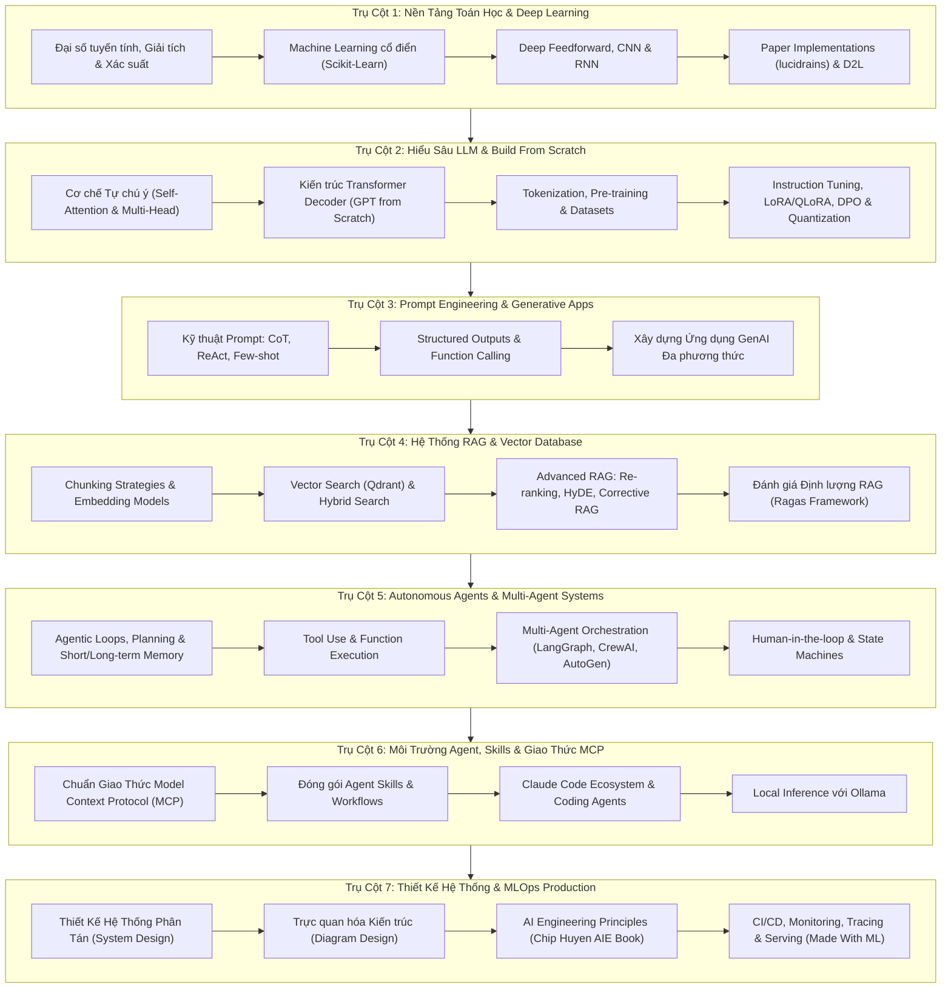
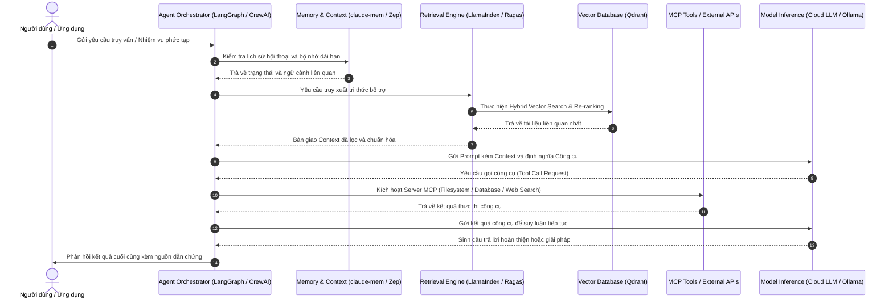

# AI Engineering, Autonomous Agents & LLM Master Hub

Kho tài nguyên tri thức, giáo trình thực hành và mã nguồn toàn diện bậc nhất về AI Engineering, Large Language Models (LLM), Hệ thống Tác tử Tự hành (Autonomous Multi-Agent Systems), Kiến trúc Truy xuất Tăng cường (RAG) và Quy trình MLOps cấp độ Production.

Dự án được cấu trúc độc lập 100%, phục vụ mục tiêu học tập chuyên sâu, làm chủ công nghệ và trực tiếp xây dựng các hệ sinh thái AI có khả năng triển khai thực tế.

---

## 1. Kiến Trúc Tổng Thể Kho Lưu Trữ

Hệ thống được tổ chức phân tầng rõ rệt giữa các ứng dụng mẫu tại thư mục gốc và 50 chương trình chuyên sâu trong thư mục `curated-courses/`:

```
AI-ENGINEERING-HUB/
|-- [93+ Root Projects]             # Các ứng dụng RAG, Vision, MCP, Fine-Tuning thực tế
|-- curated-courses/                # 50 kho giáo trình, framework và tài nguyên tích hợp
|   |-- aie-book-chiphuyen/         # AI Engineering Book (Chip Huyen)
|   |-- langchain-framework/       # Core LangChain Framework
|   |-- langgraph-orchestration/    # Stateful Multi-Agent Graph Engine
|   |-- crewai-multi-agent/         # Production Multi-Agent Systems
|   |-- qdrant-vector-database/     # Rust-based High Performance Vector DB
|   |-- ragas-eval-framework/       # Quantitative RAG Evaluation Engine
|   |-- ollama-local-llms/          # Local LLM Inference Engine
|   |-- awesome-mcp-servers-catalog/# Danh mục Model Context Protocol
|   |-- mcp-reference-servers/      # Bộ máy chủ MCP mẫu chuẩn hóa
|   |-- superpowers-coding-skills/  # Bộ kỹ năng và kiểm thử cho coding agent
|   |-- claude-code-agents-suite/   # Hệ thống tác tử điều phối Claude Code
|   |-- claude-mem-plugin/          # Plugin nén và ghi nhớ ngữ cảnh phiên làm việc
|   |-- claude-flow-orchestration/  # Điều phối workflow đa tác tử ruFlo
|   |-- planning-with-files/        # Quản trị tiến độ và bộ nhớ bằng Markdown
|   |-- claude-scientific-skills/   # Kỹ năng phân tích số liệu và nghiên cứu khoa học
|   |-- claude-code-guide/          # Cẩm nang cấu hình Claude Code và SKILL.md
|   |-- oh-my-claudecode/           # Bộ công cụ mở rộng đa tác tử dựng sẵn
|   |-- ecc-agent-harness/          # Tối ưu harness, bảo mật và trí nhớ agent
|   |-- teamai-cli-tencent/         # CLI chia sẻ kỹ năng và cấu hình nhóm (Tencent)
|   |-- pi-desktop-agent-env/       # Môi trường desktop local-first cho coding agent
|   |-- openai-plugins/             # Kho lưu trữ tích hợp plugins từ OpenAI
|   |-- diagram-design/             # Thiết kế sơ đồ kiến trúc chuẩn cho AI tools
|   |-- system-design-notes/        # Thiết kế hệ thống phân tán quy mô lớn
|   |-- ultimate-ai-engineer-roadmap-2026/ # Lộ trình AI Engineer chuẩn 2026
|   |-- microsoft-ml-for-beginners/ # 12 tuần Machine Learning kinh điển qua Scikit-Learn
|   |-- microsoft-ai-for-beginners/ # Mạng neural, Computer Vision, NLP (PyTorch/TF)
|   |-- microsoft-generative-ai-for-beginners/ # 21 bài học xây dựng ứng dụng GenAI
|   |-- microsoft-ai-agents-for-beginners/ # 18 bài học chuyên sâu về AI Agents
|   |-- microsoft-autogen/          # Framework đàm thoại đa tác tử của Microsoft
|   |-- karpathy-nn-zero-to-hero/   # Xây dựng mạng neuron từ micrograd đến GPT
|   |-- karpathy-nanochat/          # Toàn trình huấn luyện mô hình và giao diện chat
|   |-- rasbt-llms-from-scratch/    # Tự lập trình GPT hoàn chỉnh từ đầu bằng PyTorch
|   |-- llm-course/                 # Lộ trình LLM Scientist & Engineer (Maxime Labonne)
|   |-- huggingface-llm-course/     # Giáo trình chính thức từ Hugging Face
|   |-- ai-engineering-from-scratch/# Transformer, Attention, Vector DB từ số 0
|   |-- rag-techniques-nirdiamant/  # Bách khoa toàn thư kỹ thuật RAG nâng cao
|   |-- genai-agents/               # Kiến trúc Agent thực chiến (Planning, Memory)
|   |-- llama-index-core/           # Data framework kết nối dữ liệu riêng với LLM
|   |-- awesome-llm-apps/           # 100+ ứng dụng Agent và RAG hoàn chỉnh
|   |-- claude-cookbooks/           # Hướng dẫn tool use, structured output từ Anthropic
|   |-- anthropic-agent-skills/     # Tiêu chuẩn đóng gói kỹ năng cho Agent
|   |-- agentic-loop-engineering/   # Thiết kế vòng lặp điều khiển trạng thái Agent
|   |-- deep-learning-paper-implementations/ # 60+ mô hình PyTorch theo paper kinh điển
|   |-- dive-into-deep-learning/    # Sách tương tác D2L đa framework kèm code
|   |-- deep-learning-book/         # Sách giáo khoa Deep Learning của Ian Goodfellow
|   |-- prompt-engineering-guide/   # Cẩm nang kỹ thuật prompt chuẩn quốc tế
|   |-- made-with-ml/               # MLOps, CI/CD và vận hành mô hình production
|   |-- learn-ai-engineering/       # Bản đồ kiến trúc hệ thống AI Engineer
|   |-- ai-expert-roadmap/          # Sơ đồ kỹ năng Machine Learning & AI
|   `-- awesome-machine-learning/   # Danh bạ thư viện ML theo mọi ngôn ngữ
|-- README.md                       # Tài liệu hướng dẫn trung tâm
`-- LICENSE                         # Giấy phép mã nguồn mở MIT
```

---

## 2. Sơ Đồ Lộ Trình Học Tập Toàn Diện



---

## 3. Kiến Trúc Luồng Dữ Liệu Của Hệ Thống AI Production

Sơ đồ quy trình thực thi từ khâu tiếp nhận yêu cầu, truy xuất dữ liệu ngữ cảnh đến điều phối tác tử và trả kết quả:



---

## 4. Danh Mục 50 Dự Án Chuyên Sâu (`curated-courses/`)

### Nhóm 1: Nền Tảng Machine Learning & Deep Learning
Các dự án xây dựng gốc rễ toán học và thuật toán từ căn bản đến nâng cao.

| STT | Tên Thư Mục | Tác Giả / Tổ Chức | Nội Dung Trọng Tâm |
|---|---|---|---|
| 1 | [`microsoft-ml-for-beginners`](./curated-courses/microsoft-ml-for-beginners) | Microsoft | Khóa học 12 tuần về học máy cổ điển qua Scikit-Learn với bài tập dữ liệu thực tế. |
| 2 | [`microsoft-ai-for-beginners`](./curated-courses/microsoft-ai-for-beginners) | Microsoft | Giáo trình mạng neuron, Computer Vision, NLP và Transformers trên PyTorch/TensorFlow. |
| 3 | [`karpathy-nn-zero-to-hero`](./curated-courses/karpathy-nn-zero-to-hero) | Andrej Karpathy | Tự lập trình từ vi phân tự động micrograd, makemore đến GPT từ con số 0. |
| 4 | [`deep-learning-book`](./curated-courses/deep-learning-book) | Ian Goodfellow | Tổng hợp và mục lục học trực tuyến cuốn giáo trình Deep Learning của MIT Press. |
| 5 | [`dive-into-deep-learning`](./curated-courses/dive-into-deep-learning) | D2L.ai | Sách giáo khoa tương tác hoàn chỉnh kèm mã nguồn chạy trên PyTorch và JAX. |
| 6 | [`deep-learning-paper-implementations`](./curated-courses/deep-learning-paper-implementations) | Phil Wang (lucidrains) | 60+ mô hình PyTorch theo paper kinh điển: Diffusion, DALL-E, ViT, Perceiver, FlashAttention. |
| 7 | [`awesome-machine-learning`](./curated-courses/awesome-machine-learning) | Joseph Misiti | Tuyển tập toàn bộ thư viện, framework học máy theo từng ngôn ngữ lập trình. |

### Nhóm 2: Hiểu Sâu LLM & Tự Xây Dựng Từ Đầu (Build From Scratch)
Đi sâu vào từng phép toán ma trận, tokenizer và quy trình tiền huấn luyện/tinh chỉnh mô hình.

| STT | Tên Thư Mục | Tác Giả / Tổ Chức | Nội Dung Trọng Tâm |
|---|---|---|---|
| 8 | [`rasbt-llms-from-scratch`](./curated-courses/rasbt-llms-from-scratch) | Sebastian Raschka | Mã nguồn tự viết GPT-2/3 từ đầu bằng PyTorch: pre-training, fine-tuning và đánh giá. |
| 9 | [`karpathy-nanochat`](./curated-courses/karpathy-nanochat) | Andrej Karpathy | Pipeline toàn trình từ tiền xử lý, huấn luyện mô hình nhỏ đến giao diện chat tương tác. |
| 10 | [`ai-engineering-from-scratch`](./curated-courses/ai-engineering-from-scratch) | Rohit Ghumare | Tự code Vector DB, Attention, Transformer Blocks, RAG và Self-Correction không phụ thuộc thư viện lớn. |
| 11 | [`llm-course`](./curated-courses/llm-course) | Maxime Labonne | Lộ trình LLM Scientist & Engineer: Tokenizer, LoRA/QLoRA, DPO, KTO, Quantization (GGUF, AWQ). |
| 12 | [`huggingface-llm-course`](./curated-courses/huggingface-llm-course) | Hugging Face | Giáo trình chính thức của Hugging Face về Transformers, PEFT, TRL và phục vụ mô hình. |

### Nhóm 3: Kỹ Thuật Prompt & Ứng Dụng Generative AI
Làm chủ việc điều khiển mô hình thông qua câu lệnh có cấu trúc và tích hợp ứng dụng.

| STT | Tên Thư Mục | Tác Giả / Tổ Chức | Nội Dung Trọng Tâm |
|---|---|---|---|
| 13 | [`prompt-engineering-guide`](./curated-courses/prompt-engineering-guide) | DAIR.AI | Cẩm nang kỹ thuật prompt chuẩn quốc tế: Zero/Few-shot, CoT, ReAct, Directional Stimulus. |
| 14 | [`microsoft-generative-ai-for-beginners`](./curated-courses/microsoft-generative-ai-for-beginners) | Microsoft | 21 bài học xây dựng ứng dụng sinh văn bản, chat, tìm kiếm và tạo ảnh. |
| 15 | [`claude-cookbooks`](./curated-courses/claude-cookbooks) | Anthropic | Hướng dẫn tool use, structured output, vision, citation và evaluation với Claude. |
| 16 | [`awesome-llm-apps`](./curated-courses/awesome-llm-apps) | Shubham Saboo | Tuyển tập hơn 100 ứng dụng RAG và Agent mẫu có thể triển khai ngay lập tức. |
| 17 | [`openai-plugins`](./curated-courses/openai-plugins) | OpenAI | Kho lưu trữ tài liệu và ví dụ mẫu về phát triển plugin cho mô hình ngôn ngữ. |

### Nhóm 4: Hệ Thống RAG & Vector Database
Kết nối LLM với nguồn dữ liệu ngoài và đo lường độ chính xác của phản hồi.

| STT | Tên Thư Mục | Tác Giả / Tổ Chức | Nội Dung Trọng Tâm |
|---|---|---|---|
| 18 | [`rag-techniques-nirdiamant`](./curated-courses/rag-techniques-nirdiamant) | Nir Diamant | Cẩm nang toàn diện: Naive RAG, Chunking, Re-ranking, HyDE, Corrective RAG, Graph RAG. |
| 19 | [`llama-index-core`](./curated-courses/llama-index-core) | LlamaIndex / Jerry Liu | Framework chuẩn hóa để ingest, parse, index và kết nối dữ liệu riêng tư với LLM. |
| 20 | [`qdrant-vector-database`](./curated-courses/qdrant-vector-database) | Qdrant | Vector database viết bằng Rust tốc độ cao, hỗ trợ tìm kiếm kết hợp và lọc payload. |
| 21 | [`ragas-eval-framework`](./curated-courses/ragas-eval-framework) | Exploding Gradients | Đánh giá định lượng RAG: Faithfulness, Answer Relevancy, Context Precision/Recall. |

### Nhóm 5: Hệ Thống Tác Tử & Điều Phối Đa Agent (Autonomous Agents)
Xây dựng các tác tử có khả năng tư duy, ghi nhớ, sử dụng công cụ và hợp tác đa vai trò.

| STT | Tên Thư Mục | Tác Giả / Tổ Chức | Nội Dung Trọng Tâm |
|---|---|---|---|
| 22 | [`langchain-framework`](./curated-courses/langchain-framework) | LangChain | Framework phổ biến nhất để xâu chuỗi các tác vụ LLM, bộ nhớ và công cụ. |
| 23 | [`langgraph-orchestration`](./curated-courses/langgraph-orchestration) | LangChain | Điều phối luồng agent có trạng thái dưới dạng đồ thị có chu trình cho các quy trình phức tạp. |
| 24 | [`crewai-multi-agent`](./curated-courses/crewai-multi-agent) | CrewAI Inc | Điều phối đội ngũ tác tử phân quyền theo vai trò (Role-Playing Autonomous Agents). |
| 25 | [`microsoft-ai-agents-for-beginners`](./curated-courses/microsoft-ai-agents-for-beginners) | Microsoft | 18 bài học về Agentic Design Patterns, Tool Use, Multi-Agent Protocols và Production. |
| 26 | [`microsoft-autogen`](./curated-courses/microsoft-autogen) | Microsoft | Framework đàm thoại đa tác tử tự động, hỗ trợ hội thoại nhóm động và thực thi mã. |
| 27 | [`genai-agents`](./curated-courses/genai-agents) | Nir Diamant | Kiến trúc agent thực tế: Phân rã mục tiêu (Planning), Ghi nhớ dài hạn, Phản tư (Reflection). |
| 28 | [`agentic-loop-engineering`](./curated-courses/agentic-loop-engineering) | Cobus Greyling | Kiến trúc thiết kế các vòng lặp phản xạ và kiểm soát trạng thái của Agent. |

### Nhóm 6: Môi Trường Agent, Skills & Chuẩn Giao Thức (MCP & Tooling)
Tối ưu hóa môi trường làm việc, bộ nhớ ngữ cảnh và chuẩn giao tiếp mở cho tác tử.

| STT | Tên Thư Mục | Tác Giả / Tổ Chức | Nội Dung Trọng Tâm |
|---|---|---|---|
| 29 | [`mcp-reference-servers`](./curated-courses/mcp-reference-servers) | Model Context Protocol | Bộ máy chủ tham chiếu chính thức: Filesystem, SQLite, Postgres, Git, Puppeteer. |
| 30 | [`awesome-mcp-servers-catalog`](./curated-courses/awesome-mcp-servers-catalog) | punkpeye | Danh mục tổng hợp tất cả máy chủ MCP sản xuất sẵn có trên toàn cầu. |
| 31 | [`anthropic-agent-skills`](./curated-courses/anthropic-agent-skills) | Anthropic | Quy chuẩn đóng gói hướng dẫn và kịch bản dưới dạng kỹ năng agent tái sử dụng. |
| 32 | [`superpowers-coding-skills`](./curated-courses/superpowers-coding-skills) | obra | Bộ framework skill và quy trình kiểm thử nâng cao cho coding agents. |
| 33 | [`claude-code-agents-suite`](./curated-courses/claude-code-agents-suite) | wshobson | Hệ thống subagents tự động hóa và phân công công việc trong Claude Code. |
| 34 | [`claude-mem-plugin`](./curated-courses/claude-mem-plugin) | thedotmack | Ghi nhớ ngữ cảnh xuyên phiên làm việc và tự động nén thông tin liên quan. |
| 35 | [`claude-flow-orchestration`](./curated-courses/claude-flow-orchestration) | ruvnet | Framework ruFlo điều phối quy trình làm việc đa tác tử quy mô lớn. |
| 36 | [`planning-with-files`](./curated-courses/planning-with-files) | OthmanAdi | Phương pháp lập kế hoạch và theo dõi tiến độ qua các tệp Markdown cấu trúc. |
| 37 | [`claude-scientific-skills`](./curated-courses/claude-scientific-skills) | K-Dense-AI | Bộ kỹ năng chuyên sâu phục vụ phân tích dữ liệu và nghiên cứu khoa học. |
| 38 | [`claude-code-guide`](./curated-courses/claude-code-guide) | zebbern | Hướng dẫn thiết lập môi trường, tệp cấu hình SKILL.md và lệnh tùy biến. |
| 39 | [`oh-my-claudecode`](./curated-courses/oh-my-claudecode) | Yeachan-Heo | Bộ tiện ích dựng sẵn nhiều agent và kỹ năng hỗ trợ triển khai nhanh chóng. |
| 40 | [`ecc-agent-harness`](./curated-courses/ecc-agent-harness) | affaan-m | Tối ưu hóa harness cho agent về mặt bảo mật, bộ nhớ và luồng nghiên cứu. |
| 41 | [`teamai-cli-tencent`](./curated-courses/teamai-cli-tencent) | Tencent | Công cụ đồng bộ và chia sẻ kỹ năng, quy tắc, cấu hình MCP trong nhóm. |
| 42 | [`pi-desktop-agent-env`](./curated-courses/pi-desktop-agent-env) | vastsa | Môi trường desktop cục bộ tối ưu hóa riêng cho các agent lập trình. |
| 43 | [`ollama-local-llms`](./curated-courses/ollama-local-llms) | Ollama | Chạy mô hình mã nguồn mở cục bộ hỗ trợ suy luận và kiểm thử offline. |

### Nhóm 7: Thiết Kế Hệ Thống & Trực Quan Hóa (System Design)
Nắm vững kiến trúc phần mềm quy mô lớn, chịu tải cao và vẽ sơ đồ kỹ thuật.

| STT | Tên Thư Mục | Tác Giả / Tổ Chức | Nội Dung Trọng Tâm |
|---|---|---|---|
| 44 | [`system-design-notes`](./curated-courses/system-design-notes) | liquidslr | Tuyển tập ghi chú thiết kế hệ thống phân tán, sharding, caching, message queues. |
| 45 | [`diagram-design`](./curated-courses/diagram-design) | Cathryn Lavery | Thư viện mẫu thiết kế biểu đồ hệ thống đẹp chuẩn cho AI tools và tài liệu. |

### Nhóm 8: Lộ Trình Kỹ Năng & MLOps Production
Quy trình đưa mô hình từ nghiên cứu sang vận hành sản xuất thực tế có giám sát và CI/CD.

| STT | Tên Thư Mục | Tác Giả / Tổ Chức | Nội Dung Trọng Tâm |
|---|---|---|---|
| 46 | [`aie-book-chiphuyen`](./curated-courses/aie-book-chiphuyen) | Chip Huyen | Tài nguyên, bài tập và phân tích từ cuốn sách kinh điển AI Engineering của Chip Huyen. |
| 47 | [`made-with-ml`](./curated-courses/made-with-ml) | Goku Mohandas | Khóa học MLOps thực chiến: kiểm thử dữ liệu, tracking MLflow, Docker, CI/CD Actions. |
| 48 | [`ultimate-ai-engineer-roadmap-2026`](./curated-courses/ultimate-ai-engineer-roadmap-2026) | Prince Singh | Bản đồ lộ trình toàn diện cho kỹ sư AI cập nhật mới nhất năm 2026. |
| 49 | [`learn-ai-engineering`](./curated-courses/learn-ai-engineering) | Ashish Pratap Singh | Lộ trình kỹ năng và kiến trúc hệ thống phục vụ thiết kế sản phẩm AI. |
| 50 | [`ai-expert-roadmap`](./curated-courses/ai-expert-roadmap) | AMAI-GmbH | Sơ đồ định hướng nghề nghiệp chi tiết trong lĩnh vực AI và Data Science. |

---

## 5. Danh Mục 93+ Dự Án Thực Hành Độc Lập Tại Thư Mục Gốc

Tất cả các dự án dưới đây nằm ngay tại thư mục gốc của repository, mỗi dự án đều có mã nguồn hoàn chỉnh có thể chạy độc lập:

### Phân Loại Theo Mức Độ Độ Khó

#### Mức Độ 1: Cơ Bản (Beginner)
* `LaTeX-OCR-with-Llama`: Chuyển đổi công thức toán từ ảnh sang mã LaTeX bằng Llama 3.2 Vision.
* `llama-ocr`: Ứng dụng OCR chạy offline 100% trên máy tính với Streamlit và Llama 3.2.
* `gemma3-ocr`: Trích xuất văn bản có cấu trúc sử dụng mô hình Gemma-3.
* `qwen-2.5VL-ocr`: OCR đa ngôn ngữ sử dụng mô hình thị giác ngôn ngữ Qwen 2.5.
* `local-chatgpt with DeepSeek`: Giao diện mini-ChatGPT chạy cục bộ với DeepSeek-R1 và Chainlit.
* `local-chatgpt`: Giao diện trò chuyện cục bộ với Llama 3.2 Vision.
* `deepseek-thinking-ui`: Giao diện trực quan hóa quá trình suy nghĩ (Thinking UI) của DeepSeek-R1.
* `qwen3-thinking-ui`: Giao diện suy luận sử dụng Qwen3:4B và Streamlit.
* `streaming-ai-chatbot`: Hệ thống truyền phát stream câu trả lời thời gian thực qua Motia framework.
* `simple-rag-workflow`: Quy trình RAG cơ bản sử dụng LlamaIndex và Ollama.
* `document-chat-rag`: Hỏi đáp tài liệu PDF sử dụng mô hình Llama 3.3.
* `fastest-rag-stack`: Stack RAG tốc độ cao kết hợp SambaNova, LlamaIndex và Qdrant.
* `github-rag`: Chat trực tiếp với mã nguồn các kho GitHub chạy trên máy cục bộ.
* `modernbert-rag`: Ứng dụng RAG sử dụng bộ nhúng ModernBERT hiện đại.
* `llama-4-rag`: Kiến trúc RAG tối ưu cho dòng mô hình Meta Llama 4.
* `imagegen-janus-pro`: Sinh ảnh cục bộ sử dụng DeepSeek Janus-Pro 7B.
* `video-rag-gemini`: Hỏi đáp nội dung video thông minh sử dụng Gemini AI.
* `Website-to-API-with-FireCrawl`: Chuyển đổi website bất kỳ thành API dữ liệu có cấu trúc.
* `ai_news_generator`: Hệ thống tự động tạo tin tức AI sử dụng CrewAI và Cohere.

#### Mức Độ 2: Trung Cấp (Intermediate - RAG & MCP Nâng Cao)
* `agentic_rag` & `agentic_rag_deepseek`: RAG tự kiểm định tính phù hợp của tài liệu và tự sửa truy vấn.
* `fast-agentic-rag-llamaindex`: Agentic RAG hiệu năng cao với LlamaIndex.
* `lightrag-multimodal`: Kiến trúc LightRAG hỗ trợ dữ liệu văn bản và hình ảnh kết hợp.
* `graphrag-orchestration`: Kết hợp đồ thị tri thức (Knowledge Graph) với vector retrieval để trả lời tổng thể.
* `cursor_linkup_mcp`: MCP Server kết nối tìm kiếm web sâu dành cho Cursor IDE.
* `eyelevel-mcp-rag`: Máy chủ MCP cho hệ thống RAG trên tài liệu kỹ thuật phức tạp.
* `llamaindex-mcp`: Client MCP cục bộ tích hợp LlamaIndex.
* `mcp-agentic-rag`: RAG agentic đóng gói chuẩn Model Context Protocol.
* `mcp-video-rag`: Video RAG sử dụng dịch vụ Ragie thông qua giao thức MCP.
* `mcp-voice-agent`: Tác tử giọng nói sử dụng Firecrawl, Supabase và MCP.
* `sdv-mcp`: Điều phối sinh dữ liệu tổng hợp (Synthetic Data Vault) qua MCP.
* `stagehand x mcp-use`: Tự động hóa trình duyệt web kết hợp giữa Stagehand và MCP.
* `eval-and-observability`: Giám sát và đánh giá toàn trình RAG qua CometML Opik.
* `code-model-comparison`: So sánh khả năng sinh mã nguồn giữa các mô hình lớn.

#### Mức Độ 3: Nâng Cao (Advanced - Fine-Tuning & Multi-Agent)
* `DeepSeek-finetuning`: Hướng dẫn tinh chỉnh mô hình DeepSeek với Unsloth và Ollama tiết kiệm VRAM.
* `Build-reasoning-model`: Xây dựng mô hình suy luận từ đầu tương tự DeepSeek-R1.
* `attention-is-all-you-need-impl`: Lập trình chi tiết kiến trúc Transformer gốc từ bài báo của Google.
* `Multi-Agent-deep-researcher-mcp-windows-linux`: Hệ thống nghiên cứu sâu đa tác tử MCP hỗ trợ Windows và Linux.
* `web-browsing-agent`: Tác tử duyệt web tự động với CrewAI và Stagehand.
* `paralegal-agent-crew`: Đội ngũ trợ lý pháp lý thông minh tích hợp RAG.
* `notebook-lm-clone`: Phiên bản clone đầy đủ của Google NotebookLM: RAG, trích dẫn, podcast đàm thoại.
* `groundX-doc-pipeline`: Pipeline xử lý tài liệu doanh nghiệp chuẩn quốc tế.
* `ultimate-ai-assitant-using-mcp`: Giao diện Streamlit kết nối đa máy chủ MCP Server đồng thời.

---

## 6. Hướng Dẫn Cài Đặt Môi Trường & Thực Thi

### Yêu Cầu Phần Cứng & Phần Mềm
* Hệ điều hành: Windows 10/11, Ubuntu 20.04+, hoặc macOS.
* Python: Phiên bản 3.10 trở lên (khuyến nghị Python 3.11).
* Git: Phiên bản mới nhất có hỗ trợ Git LFS.
* Bộ nhớ RAM: Tối thiểu 16 GB (khuyến nghị 32 GB cho các bài toán huấn luyện mô hình).
* GPU (tùy chọn): GPU NVIDIA hỗ trợ CUDA 12.x để chạy suy luận hoặc fine-tuning cục bộ.

### Các Bước Khởi Tạo Môi Trường

1. Khởi tạo môi trường ảo với Conda hoặc venv:
```bash
conda create -n ai-master python=3.11 -y
conda activate ai-master
```

2. Cài đặt PyTorch với hỗ trợ tăng tốc CUDA (ví dụ CUDA 12.1):
```bash
pip install torch torchvision torchaudio --index-url https://download.pytorch.org/whl/cu121
```

3. Cài đặt các thư viện lõi cho AI Engineering:
```bash
pip install transformers datasets peft accelerate trl bitsandbytes
pip install langchain langchain-community langgraph crewai llama-index
pip install qdrant-client ragas scikit-learn numpy pandas
```

4. Chạy thử nghiệm một module học tập:
Mỗi thư mục trong `curated-courses/` hoặc tại thư mục gốc đều có tệp tài liệu hướng dẫn và mã nguồn độc lập. Di chuyển vào thư mục tương ứng và khởi chạy:

```bash
# Ví dụ 1: Chạy mô hình LLM from scratch của Sebastian Raschka
cd curated-courses/rasbt-llms-from-scratch
pip install -r requirements.txt
python -m unittest

# Ví dụ 2: Chạy hệ thống RAG cơ bản tại thư mục gốc
cd simple-rag-workflow
python app.py
```

---

## 7. Quy Định Đóng Góp & Giấy Phép Sử Dụng

* Dự án được phân phối theo giấy phép mã nguồn mở MIT License.
* Mã nguồn và tài liệu tích hợp từ các kho mở cộng đồng tuân thủ giấy phép gốc tương ứng của từng tác giả sáng lập.
* Kho lưu trữ này được xây dựng cho mục đích học tập cá nhân, nghiên cứu phát triển và đóng góp cho cộng đồng kỹ thuật AI.
